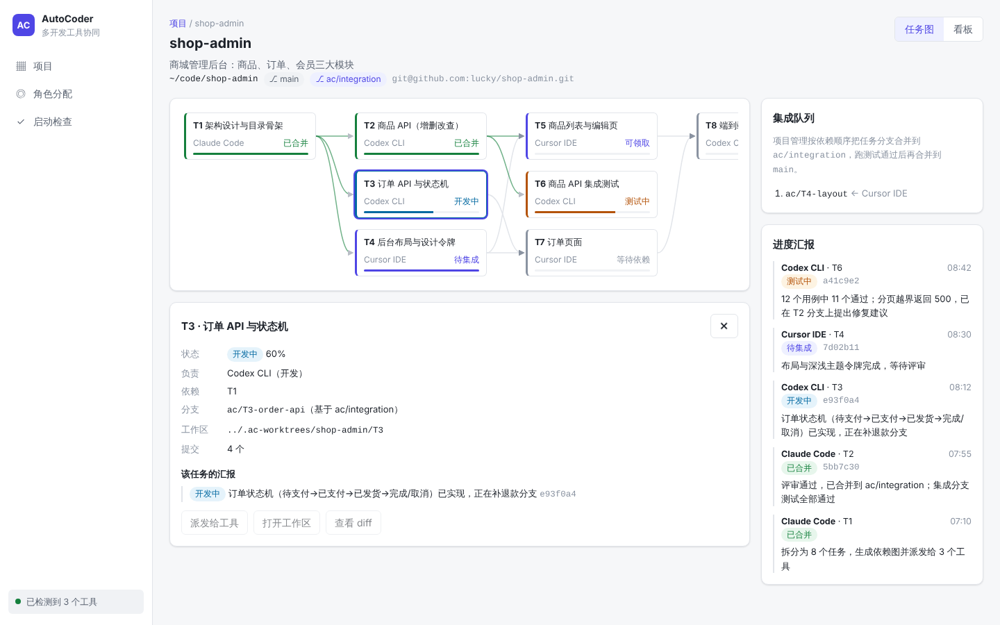

# AutoCoder

单台设备上多个 AI 开发工具（Claude Code、Codex、Cursor……）的协同助手：
启动时检测本机已安装的工具，按能力分配 **架构与项目管理 / 开发 / 前端 / 测试 / 评审** 角色，
以 **git 仓库** 为核心管理项目——任务即分支、汇报即提交、集成即合并。

设计与规划见 [docs/DESIGN.md](docs/DESIGN.md)。

## 当前进度（M0）

- ✅ 工具清单与启动检测（`internal/toolscan`，可用 `~/.autocoder/tools.yaml` 自定义）
- ✅ 默认角色分配（`internal/roles`）
- ✅ 界面原型：启动检查、角色分配、项目列表、项目详情（任务图/看板/进度汇报）
- ⏳ 项目与任务的真实 git 操作、任务派发与汇报解析（见路线图）

## 快速开始

需要 Go 1.24+、Node 20+。

```bash
make build          # 构建前端并打进单文件 bin/autocoder
./bin/autocoder     # 打开 http://127.0.0.1:7788
./bin/autocoder tools   # 只在终端里做工具检测
```

前端开发：

```bash
go run ./cmd/autocoder          # 后端 API（7788）
npm --prefix web run dev        # Vite 开发服务器，/api 自动转发
```

其他命令：`make test`、`make release`（交叉编译 linux/darwin/windows × amd64/arm64）。

## 截图

| 启动检查 | 项目任务图 |
|---|---|
|  |  |
