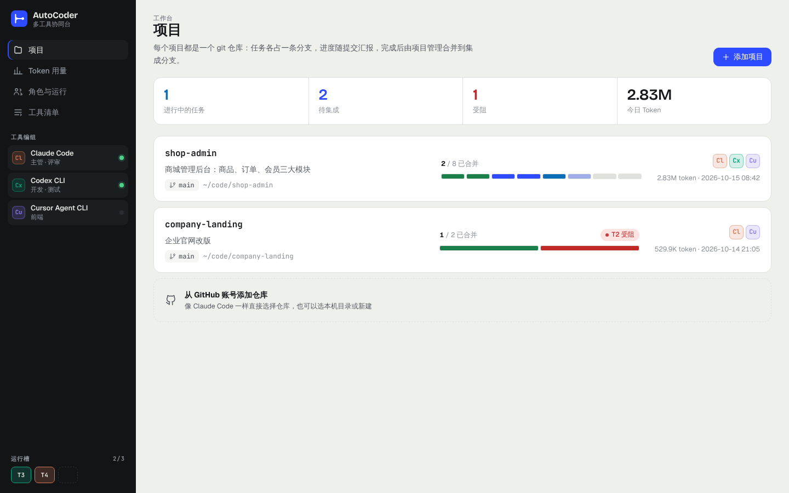
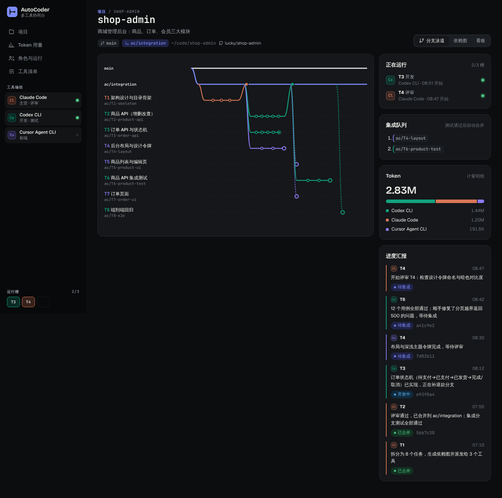
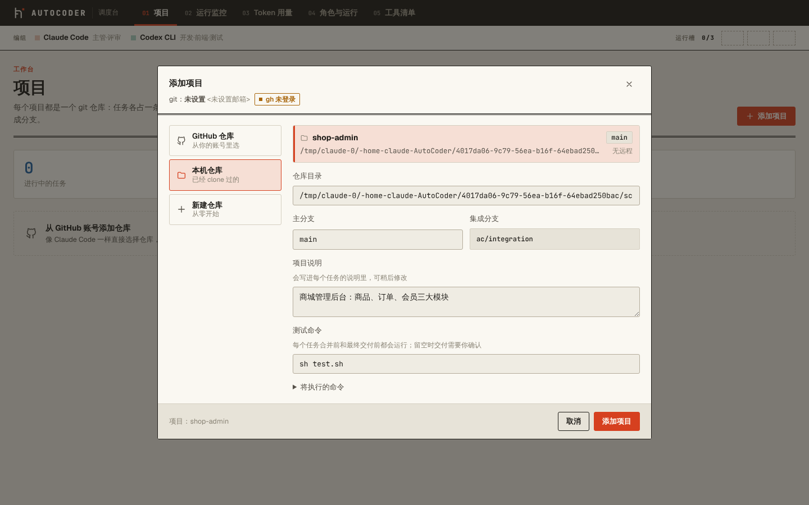
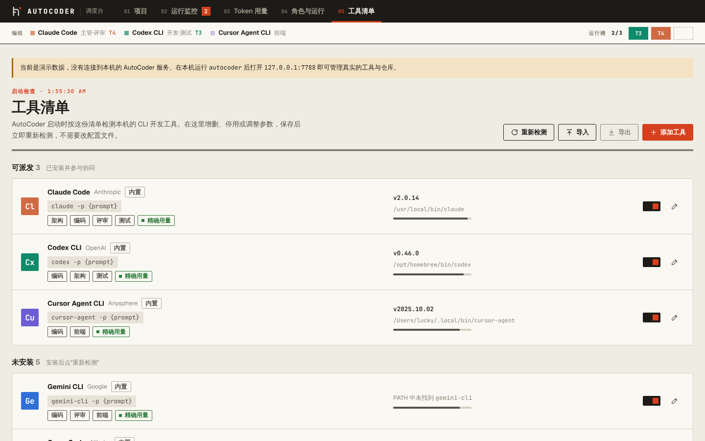
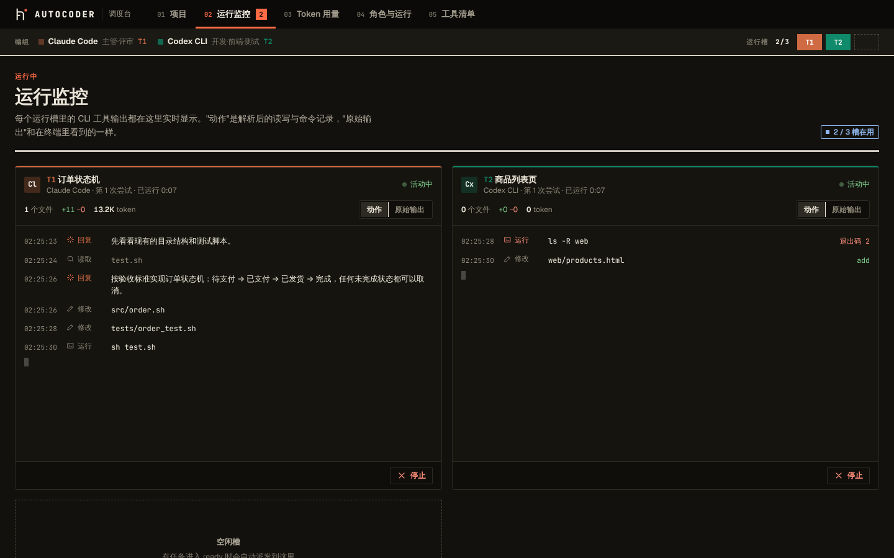
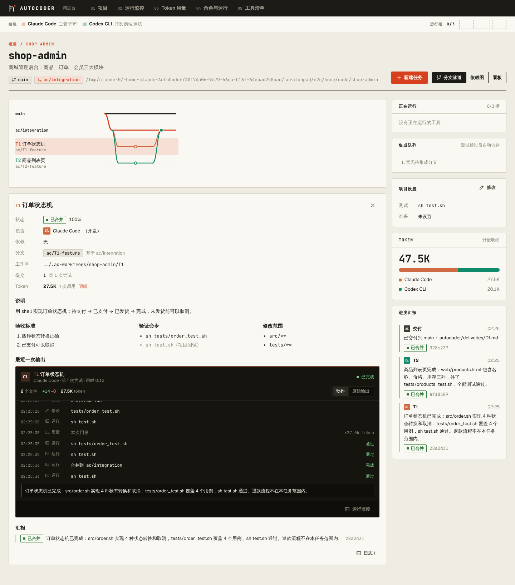
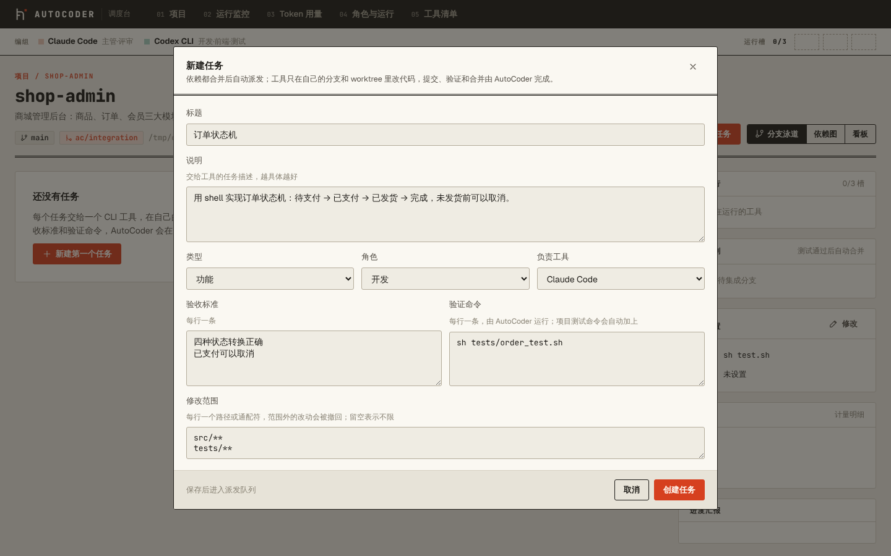
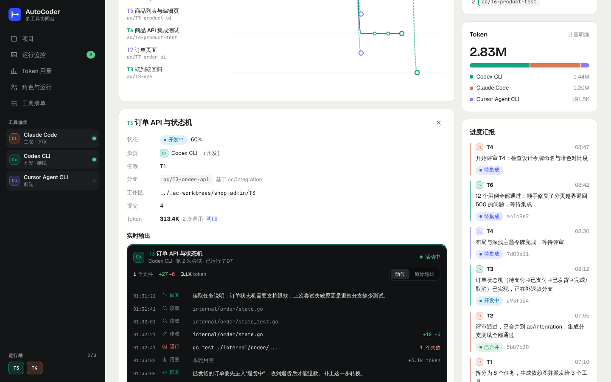
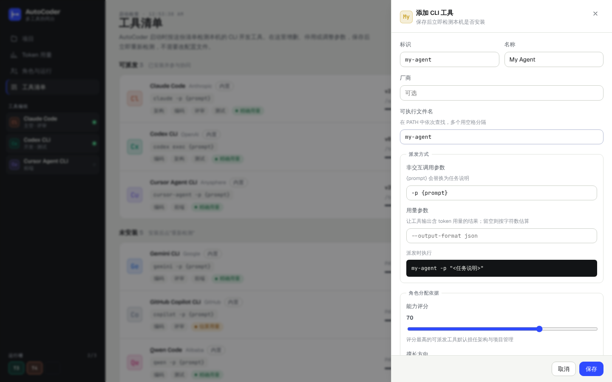
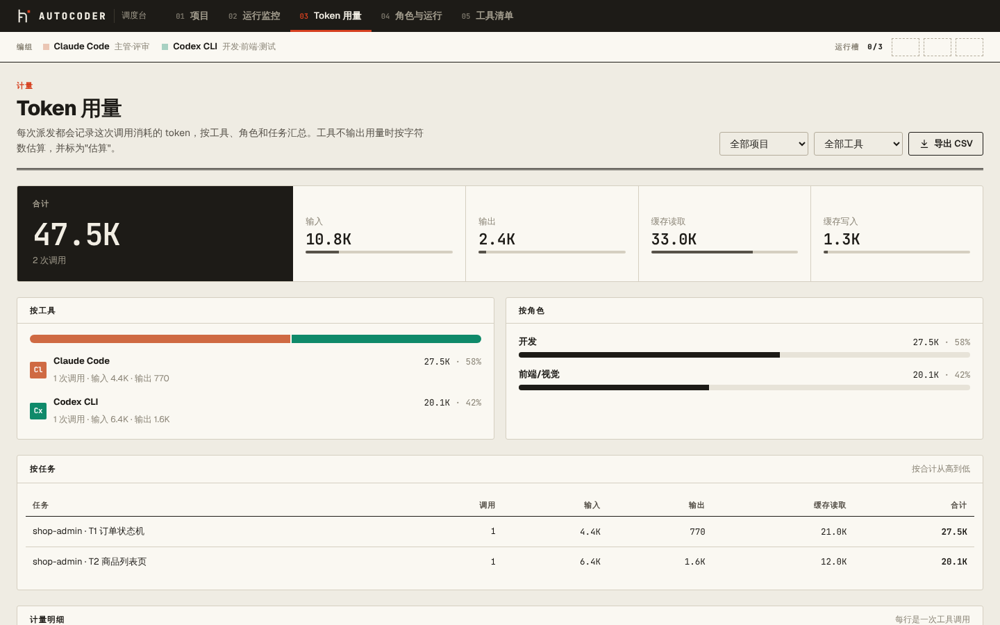

# AutoCoder

单台设备上多个 AI 开发工具（Claude Code、Codex、Cursor……）的协同助手：
启动时检测本机已安装的工具，按能力分配 **架构与项目管理 / 开发 / 前端 / 测试 / 评审** 角色，
以 **git 仓库** 为核心管理项目——任务即分支、汇报即提交、集成即合并。

设计与规划见 [docs/DESIGN.md](docs/DESIGN.md)。

## 当前进度（M2，含部分 M3）

- ✅ 工具清单与启动检测，清单在界面上直接增删改、启停、导入导出，包括无人值守、事件流、只读参数和"未登录 / 限流"关键字（`internal/toolscan`）
- ✅ 角色分配与运行设置保存在 `~/.autocoder/settings.json`（`internal/roles`、`internal/settings`）
- ✅ 从 GitHub 账号克隆、接管本机仓库或新建仓库；状态写在集成 worktree 的 `.autocoder/` 并提交到 `ac/integration`，不碰你的工作目录（`internal/project`、`internal/gitops`）
- ✅ 任务派发：运行槽、按角色改派、进程组、日志、卡住与超时、范围检查、危险改动确认、验证命令、带 trailer 的提交、自动重试（`internal/dispatch`）
- ✅ 实时输出：解析 Claude Code / Cursor 的 stream-json、Codex 的 `--json` 事件、Gemini / Qwen 的 json 结果，SSE 推送与断点续传
- ✅ Token 计量：每次调用一条记录，工具不上报时按字符数估算并标注
- ✅ 集成队列与交付：`--no-ff` 合并到 `ac/integration`，合并后测试失败自动退回；全部合并后在临时 worktree 中生成交付合并，主目录干净时快进
- ⏳ M3 余下部分：lead 从一句需求生成并校验计划、评审角色、"等你处理"汇总页（见路线图）

> 各工具的无人值守参数随版本变化，内置默认值按常见版本填写。第一次用某个工具前，建议在「工具清单」里核对它的参数。

## 快速开始

需要 Go 1.24+、Node 20+。

```bash
make build          # 构建前端并打进单文件 bin/autocoder
./bin/autocoder     # 打开 http://127.0.0.1:7788
./bin/autocoder tools   # 只在终端里做工具检测
```

前端开发：

```bash
go run ./cmd/autocoder          # 后端 API（7788）
npm --prefix web run dev        # Vite 开发服务器，/api 自动转发
```

其他命令：`make test`、`make release`（交叉编译 linux/darwin/windows × amd64/arm64）。

## 截图

| 项目 | 分支泳道（深色） |
|---|---|
|  |  |
| **添加项目** | **工具清单** |
|  |  |
| **运行监控（两个工具并行，真实进程）** | **任务完成并交付后的项目详情** |
|  |  |
| **新建任务** | **项目详情中的实时输出（演示数据）** |
|  |  |
| **编辑工具** | **Token 用量** |
|  |  |
